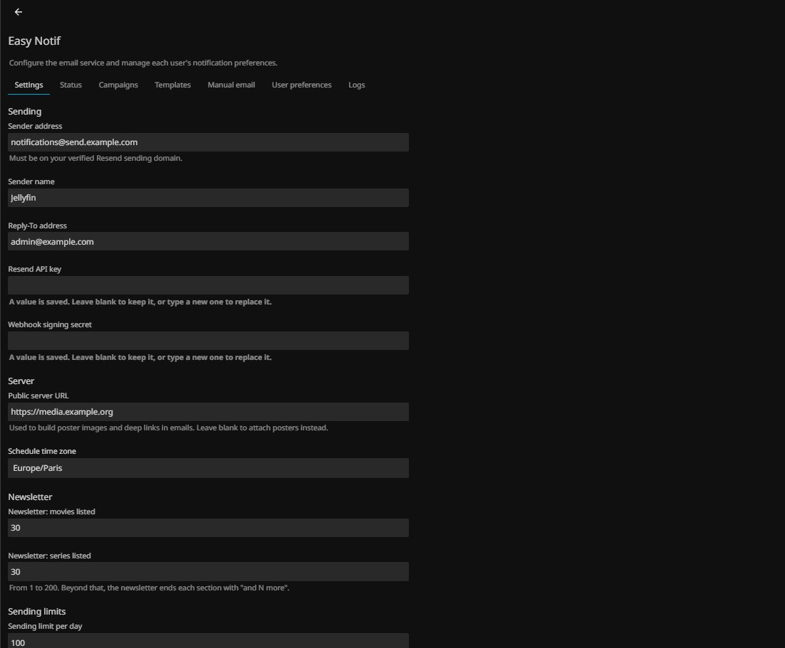
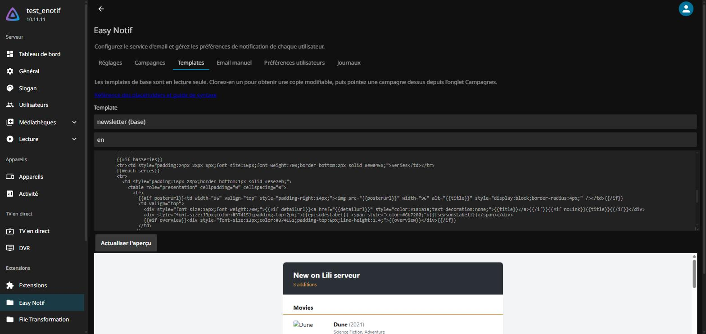

# Easy Notif

<p align="center">
  
  
  
  
</p>

An internal **email notification service** for your Jellyfin server. It replaces ad-hoc messaging
with:

- a **new-media newsletter** on a schedule you choose (weekly on a given day, monthly, every N days,
  or daily), with cover art and links back to each title;
- a **personalised weekly recap** for each user: what they watched this week, up to three titles to
  pick up where they left off, and their running total for the year;
- **new-episode notifications** for the series each user follows, with a bell on the series page;
- **announcements** written from the dashboard, sent now or at a date you pick, as plain text, full
  HTML, or laid out with the Easy Notif template;
- **incident alerts** for the admin: a banner on the config page and, if you set an address, one
  digest email a day when something went wrong.

Each user picks which categories they want, which libraries feed their newsletter, and sets their
own contact address. Every email respects what each user is allowed to see in Jellyfin. The plugin
reads the library and playback data only. It never changes anything.

Part of the [JellyUX](https://github.com/JellyUX) plugin family.

---

## Screenshots

<p align="center">
  <br>
  <em>The Settings tab, grouped in sections. The Status, Campaigns, Templates, Manual email, User
  preferences and Logs tabs sit alongside it.</em>
</p>

<p align="center">
  <br>
  <em>The Templates tab: clone a base template, edit the HTML, preview it with sample data.</em>
</p>

## Requirements

- **Jellyfin 10.11.10 or newer** (10.11.x line).
- The **[File Transformation plugin](https://github.com/IAmParadox27/jellyfin-plugin-file-transformation)**,
  used to inject the per-user settings panel, the series bell and the invitation banner into the
  web client. Without it they do not appear; the rest of the plugin still works.
- A **[Resend](https://resend.com)** account (free tier is enough) and a domain you can add DNS
  records to. You will publish SPF, DKIM and DMARC records for a dedicated sending sub-domain, and
  create an API key with **Sending access** scoped to that sub-domain.

## Installation

1. Jellyfin dashboard: **Plugins > Repositories > Add**, paste one of:
   ```
   https://raw.githubusercontent.com/JellyUX/Easy_Notif/main/manifest.json
   ```
   or, for the whole JellyUX suite:
   ```
   https://raw.githubusercontent.com/JellyUX/.github/main/manifest.json
   ```
2. **Plugins > Catalog**, install **Easy Notif**, restart Jellyfin.
3. Open **Dashboard > Plugins > Easy Notif**.

## Configuration

### 1. Sending domain (Resend)

Add a **dedicated sub-domain** in Resend (for example `send.example.com`, not the root domain, so
your existing mail is never touched). Resend gives you an MX record, an SPF `TXT` and a DKIM `TXT`;
add them at your DNS host as **plain records, not proxied**, then add a DMARC `TXT` on
`_dmarc.send.example.com` (`v=DMARC1; p=none; rua=mailto:you@example.com`). Click **Verify** until
all records are green.

### 2. API key and webhook

- **API Keys > Create API Key**: permission **Sending access**, scoped to the sub-domain. Copy the
  `re_...` value once.
- **Webhooks > Add Endpoint**: URL `https://<your-jellyfin>/EasyNotif/webhooks/resend`, events
  `email.sent`, `email.delivered`, `email.delivery_delayed`, `email.bounced`, `email.complained`,
  `email.suppressed`. Copy the `whsec_...` **Signing Secret**.

The webhook is what makes bounces and complaints count: an address that bounces permanently (or
that Resend suppresses) is no longer mailed until its owner saves it again, and a spam complaint
turns off every category for that user.

### 3. The Settings tab

Fill in the **Settings** tab of the plugin config page. The fields are grouped in sections:

| Section | Field | Value |
|---|---|---|
| Sending | Sender address | any address on the verified sub-domain (it does not need a real mailbox) |
| | Sender name | what recipients see as the sender |
| | Reply-To address | optional; a real address if you want replies to reach you |
| | Resend API key | the `re_...` key (stored in the plugin's data directory, masked on read, never logged) |
| | Webhook signing secret | the `whsec_...` secret |
| Server | Public server URL | your Jellyfin's public URL, used for poster images and deep links. Leave blank to attach the posters to the email instead |
| | Schedule time zone | the time zone of every schedule (Europe/Paris by default; UTC if the zone is unknown) |
| Newsletter | Movies listed / Series listed | 1 to 200 each (30 by default); beyond that, a section ends with "and N more" |
| Sending limits | Per day / Over 30 days | your Resend plan's quotas (100 and 3000 on the free plan; 0 per day if your plan has no daily limit) |
| Incident alerts | Address and language | where the daily incident digest goes; leave empty to rely on the banner of the config page |
| Web interface | Three switches | add the settings panel to Jellyfin Web, show the follow bell on series pages, invite users without a contact email (each takes effect after a Jellyfin restart) |

The **Status** tab shows the Resend transport, the sends of today and of the last 30 days, the last
webhook received, each campaign's next run and last error, the background writers, the incidents of
the last 7 days and the latest sends (with masked addresses).

## Using it

- **Campaigns tab**: the newsletter and the weekly recap ship disabled. Set a schedule, pick a
  language and (optionally) a custom template, enable it. **Send a preview to me** mails the current
  content to your own contact address; for the recap, it is filled with your own viewing.
- **Templates tab**: the built-in templates are read-only. Clone the newsletter or the recap, edit
  the HTML, preview it with sample data, and point a campaign at your copy. The new-episode and
  announcement templates can be previewed but not cloned. Placeholder reference and the template
  mini-language: [docs/CUSTOM_TEMPLATES.md](docs/CUSTOM_TEMPLATES.md).
- **Manual email tab**: an announcement, plain text or HTML, with attachments up to 10 MB. Tick
  **Lay out with the Easy Notif template** to wrap it in the house style (French or English).
  **All users** reaches everyone with a contact address except the users who turned off
  announcements; **Selected users** reaches the users you tick, whatever their preferences, and
  carries no unsubscribe link. Send it now, or **schedule** it for a later date (without
  attachments); upcoming announcements are listed and can be cancelled.
- **User preferences tab**: every user's contact address and categories (new media, weekly recap,
  announcements, new episodes) with their number of followed series. You can switch new media and
  the weekly recap for a user; the rest is set by each user.
- **Logs tab**: the plugin's own log file, filterable by level.

### What each user sees

- **Settings panel** (in each user's Jellyfin settings, under **Email notifications**): contact
  address, the four categories, the libraries included in the newsletter, the followed series (with
  a Remove button), a test-send button.
- **Invitation banner**: a user with no contact address sees a banner on the home page offering to
  set one up, until they close it or follow it.
- **Unsubscribe**: every campaign email carries a one-click `List-Unsubscribe` header and a footer
  link to a small confirmation page. Changes take effect immediately.

### The weekly recap

The recap lists the week's movies and episodes, up to three titles in progress (started, not
finished, watched in the last 30 days) and the total for the year. On a server where Easy Notif
arrives mid-year, the yearly total starts from what Jellyfin already marks as watched this year:
each such title counts once, and the email says it is an estimate.

## New-episode notifications

- **Following a series**: open a series page in Jellyfin Web and click the **bell** in the action
  bar. Click it again to stop. The bell only appears on series the user can see. The followed
  series are listed in the user's settings panel, where each one can be removed.
- **What is sent**: one email per user, grouping every new episode of every followed series, with
  the series poster and a link to its page. A series with more than 5 new episodes is summed up in
  one line; specials are labelled as such. An episode already notified, or a file that only
  replaces one already in the library (an upgrade or a move), is not announced again.
- **Delay**: the email leaves once no new episode has arrived for 30 minutes, so episodes added a
  few minutes apart end up in the same email. With the 15-minute check, expect it **30 to 45
  minutes** after the last episode (at most 6 hours after the first one when episodes keep
  arriving).
- **Limits**: at most **3 new-episode emails per user per day** (UTC). They never use the share of
  the daily Resend quota held back for a campaign due the same day; what is held back goes out
  later.
- **Stopping**: each series in the email has its own "Stop following this series" link, and the
  footer has a link that stops every new-episode email (also sent as the `List-Unsubscribe`
  header). Users can also untick **New episodes** in their settings panel. A user with no contact
  address gets nothing; the bell's tooltip says so.
- **Turning it off**: on the **Settings** tab, untick **Show the follow bell on series pages**
  (takes effect after a Jellyfin restart). Existing subscriptions keep working.

## Reliability

- A send that fails for a temporary reason (network, Resend overloaded or rate limited) is retried
  15 minutes, 1 hour, 4 hours and 12 hours later, then given up and reported as an incident. Each
  email carries an idempotency key, so a retry never mails the same person twice.
- A large manual send runs in the background: you can close the page, follow its progress later and
  retry only the failures.
- When Resend refuses a send for quota, every send pauses until the next midnight UTC.
- A newsletter does not announce a title again within six months, even when a file is replaced or
  a movie is added a second time.

## Privacy and uninstall

Every piece of state the plugin keeps lives in **one directory**,
`<jellyfin-data>/Jellyfin.Plugin.EasyNotif/` (preferences, followed series, campaigns and scheduled
announcements, playback history, custom templates, send log and retry queue, quota, incidents,
secrets, logs). The only other files are the resized posters, which Jellyfin's own image processor
keeps in Jellyfin's image cache like any other cached image. Contact addresses go to **Resend**
(United States) to send the mail; nothing is sent to any other third party. Addresses and user ids
are masked in the logs.

What is stored about users, and for how long:

| Data | File | Kept |
|---|---|---|
| Contact address, categories, newsletter libraries | `preferences.json` | until the user clears it or the administrator deletes the file |
| Followed series | `series-notify.json` | until the user unfollows or the administrator deletes the file |
| Viewing history (titles watched, every user, for the weekly recap) | `playback-history.json` | 90 days |
| Send log (masked address, user id, subject, status) | `send-log.jsonl` | last 500 entries |
| Incidents | `incidents.json` | 7 days |
| Activity logs (addresses and ids masked) | `logs/` | the Jellyfin activity log retention, 30 days by default |
| Unsubscribe links in sent emails | (signed, not stored) | valid 180 days |

Only the server administrators can read these files (file system, admin page). Each user sees and
edits their own address and choices in their Jellyfin settings.

Uninstalling the plugin does **not** delete this directory: the data stays on the server until the
administrator deletes it. To remove everything: uninstall the plugin and delete that directory. The
server is then exactly as it was before.

## Development

### Smoke test against a real Jellyfin

`docker/scripts/smoke-test.ps1` builds the plugin and checks that it loads in a real, disposable
Jellyfin container. It needs Docker and Windows PowerShell; run it from the repository root:

```powershell
powershell -File docker/scripts/smoke-test.ps1 -JellyfinVersion 10.11.10
powershell -File docker/scripts/smoke-test.ps1 -JellyfinVersion 12.4
```

The script starts `jellyfin/jellyfin:<version>` (pulled if missing) on port 8100 with no host
mount, completes the startup wizard through the API, installs File Transformation from its
catalogue (Jellyfin picks the build that matches its version), copies the local Release build in
and restarts. It then checks that Easy Notif and File Transformation are `Active`, that the
anonymous `/EasyNotif/*` assets answer 200, that the served `index.html` loads `enotif-user.js`,
and that the Jellyfin log since the restart has no `[ERR]` line naming EasyNotif.

It prints a PASS/FAIL table and the run time, and exits with code 1 if any check fails. The
container is removed at the end; `-Keep` leaves it running and prints the admin credentials,
`-Port` picks another port. No email can be sent: the container has no Resend key.

## License

GPL-3.0. See [LICENSE.md](LICENSE.md).
